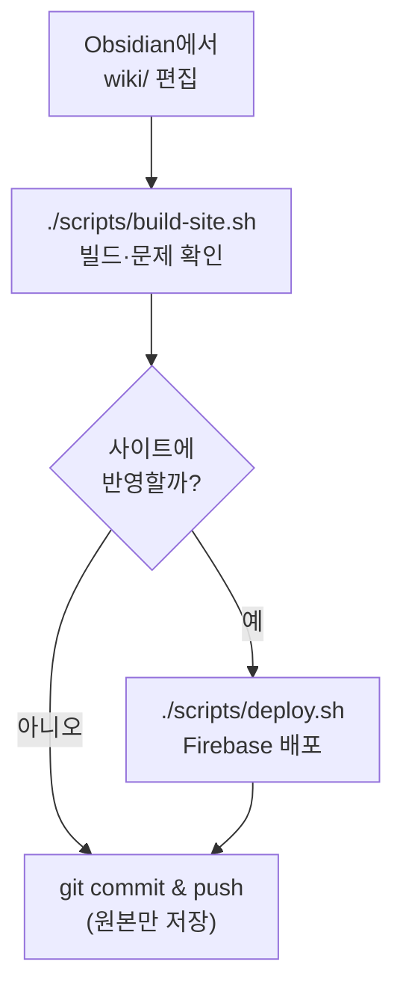

# 위키 배포 가이드 — Zensical + Firebase Hosting

Obsidian으로 쓰는 위키(`wiki/` 디렉터리)를 웹사이트로 만들어 인터넷에 공개하는 절차입니다. 지금 운영 중인 [wiki.wonslab.dev](https://wiki.wonslab.dev)의 설정 파일과 스크립트를 그대로 옮겼으므로, 같은 구조의 저장소라면 Step 1부터 순서대로 따라 하면 같은 사이트가 나옵니다. 모든 명령은 Mac 터미널 기준입니다.

!!! example "실습 위치·실행"

    - **위치**: 위키 저장소의 루트 디렉터리 (이 문서에서는 `~/my-wiki`로 씁니다. 자기 경로로 바꿔 읽습니다)
    - **준비물**: Mac, `wiki/` 디렉터리가 있는 위키 저장소, Google 계정
    - **걸리는 시간**: 처음 셋업 1~2시간, 이후 배포는 명령 한 줄에 1~2분
    - **비용**: 0원 (커스텀 도메인을 붙이면 도메인 비용만)

!!! note "이 가이드의 검증 범위"
    2026-10-24에 저장소를 새로 클론한 디렉터리에서 Step 2~6(설치·빌드·미리보기)을 다시 실행해 확인했습니다(macOS, Python 3.14, Zensical 0.0.72). Step 7~8은 같은 날 이 위키를 같은 설정 파일로 실제 배포해 확인했습니다. 빌드 결과는 이전 MkDocs 빌드와 페이지 216개, sitemap 주소 213개가 같았습니다. 처음 글은 2026-05-31에 MkDocs Material 기준으로 썼고, 2026-10-24에 Zensical 기준으로 다시 썼습니다.

## 0. 한눈에 보기

### 만들게 될 파일

이 가이드를 끝까지 따라 하면 저장소에 아래 파일이 생깁니다. 각 파일은 오른쪽에 적힌 Step에서 만듭니다. 처음에는 `wiki/`만 있으면 됩니다.

```text
~/my-wiki/
├── wiki/                     ← 원래 있던 위키 원본 (Obsidian으로 편집)
├── requirements.txt          ← 설치할 Python 패키지 목록 (Step 2)
├── .gitignore                ← git에 올리지 않을 파일 (Step 2)
├── mkdocs.yml                ← 사이트 설정 (Step 3)
├── overrides/main.html       ← 검색엔진 확인 태그 등 (Step 3)
├── scripts/
│   ├── css/extra.css         ← 글꼴·화면 조정 (Step 3)
│   ├── wikilinks.py          ← [[링크]] 변환 (Step 4)
│   ├── seo.py                ← 페이지 설명문 추출 (Step 4)
│   ├── new_badge.py          ← 새 페이지 🆕 표시 (Step 4)
│   ├── zensical_prep.py      ← 위 두 기능을 빌드 앞뒤에 실행 (Step 4)
│   ├── build-site.sh         ← 빌드 한 번에 실행 (Step 5)
│   └── deploy.sh             ← 빌드 + 배포 한 번에 실행 (Step 8)
├── firebase.json             ← Firebase 배포 설정 (Step 7)
└── .firebaserc               ← 배포할 Firebase 프로젝트 이름 (Step 7)
```

빌드하면 `docs/`(빌드용 복사본)와 `site/`(완성된 웹사이트)가 자동으로 생깁니다. 둘 다 매번 새로 만들어지므로 직접 고치지 않고, git에도 올리지 않습니다.

### 전체 흐름

<div style="display:flex;flex-direction:column;gap:14px;align-items:center;font-family:sans-serif;margin:24px 0;">

  <div style="background:#eff6ff;border:1px solid #bfdbfe;border-radius:10px;padding:16px;width:100%;box-sizing:border-box;">
    <div style="font-weight:600;margin-bottom:12px;color:#1e40af;font-size:15px;">💻 내 Mac — 편집 · 빌드 (build-site.sh)</div>
    <div style="display:flex;align-items:stretch;gap:10px;">
      <div style="background:#dbeafe;border:2px solid #2563eb;border-radius:8px;padding:14px 10px;flex:1;text-align:center;color:#1e3a8a;font-weight:500;">📝<br/>wiki/*.md<br/>편집</div>
      <div style="display:flex;align-items:center;font-size:24px;color:#2563eb;font-weight:bold;">→</div>
      <div style="background:#dbeafe;border:2px solid #2563eb;border-radius:8px;padding:14px 10px;flex:1;text-align:center;color:#1e3a8a;font-weight:500;">🔄<br/>docs/ 복사<br/>링크 변환</div>
      <div style="display:flex;align-items:center;font-size:24px;color:#2563eb;font-weight:bold;">→</div>
      <div style="background:#dbeafe;border:2px solid #2563eb;border-radius:8px;padding:14px 10px;flex:1;text-align:center;color:#1e3a8a;font-weight:500;">🏗️<br/>zensical build<br/>HTML 생성</div>
      <div style="display:flex;align-items:center;font-size:24px;color:#2563eb;font-weight:bold;">→</div>
      <div style="background:#dbeafe;border:2px solid #2563eb;border-radius:8px;padding:14px 10px;flex:1;text-align:center;color:#1e3a8a;font-weight:500;">📦<br/>site/<br/>완성된 사이트</div>
    </div>
  </div>

  <div style="font-size:28px;color:#999;line-height:1;">↓</div>

  <div style="background:#fff7ed;border:1px solid #fed7aa;border-radius:10px;padding:16px;width:100%;box-sizing:border-box;">
    <div style="font-weight:600;margin-bottom:12px;color:#7c2d12;font-size:15px;">🚀 배포 (deploy.sh)</div>
    <div style="background:#fed7aa;border:2px solid #ea580c;border-radius:8px;padding:14px;text-align:center;color:#7c2d12;font-weight:500;">🚀 firebase deploy — site/ 업로드</div>
  </div>

  <div style="font-size:28px;color:#999;line-height:1;">↓</div>

  <div style="background:#f0fdf4;border:1px solid #bbf7d0;border-radius:10px;padding:16px;width:100%;box-sizing:border-box;">
    <div style="font-weight:600;margin-bottom:12px;color:#15803d;font-size:15px;">🌐 Firebase Hosting — 공개</div>
    <div style="display:flex;align-items:stretch;gap:10px;">
      <div style="background:#bbf7d0;border:2px solid #16a34a;border-radius:8px;padding:14px;flex:1;text-align:center;color:#14532d;font-weight:500;">🌍<br/>전 세계 CDN<br/>무료 SSL</div>
      <div style="display:flex;align-items:center;font-size:24px;color:#16a34a;font-weight:bold;">→</div>
      <div style="background:#bbf7d0;border:3px solid #15803d;border-radius:8px;padding:14px;flex:1;text-align:center;color:#14532d;font-weight:600;">🔗<br/>wiki.wonslab.dev<br/>공개 주소</div>
    </div>
  </div>

</div>

그림을 글로 풀면 다음과 같습니다.

1. **편집**: Obsidian에서 `wiki/*.md`를 평소처럼 씁니다. `[[링크]]`와 frontmatter도 그대로 씁니다.
2. **빌드**: `scripts/build-site.sh` 한 줄이 `wiki/`를 `docs/`로 복사하고, Obsidian 전용 `[[링크]]`를 일반 마크다운 링크로 바꾼 뒤, Zensical로 HTML 사이트(`site/`)를 만듭니다. 이 단계까지는 내 Mac 안에서만 일어납니다.
3. **배포**: `scripts/deploy.sh`가 빌드를 한 번 더 확인하고 `site/`를 Firebase Hosting에 올립니다. 바뀐 파일만 올라가서 빠릅니다.
4. **공개**: Firebase가 전 세계 서버에 파일을 나눠 두고, 방문자는 가장 가까운 서버에서 페이지를 받습니다.

### 왜 이 조합인가

| 항목 | 선택 | 이유 |
|------|------|------|
| 사이트 생성기 | **Zensical** | Material for MkDocs 팀이 만든 후속 도구입니다. 기존 `mkdocs.yml`을 그대로 읽고, Material for MkDocs 9.7은 2027-05-05에 지원이 끝납니다(배경은 [[guide-portfolio-blog]] Step 1) |
| 호스팅 | **Firebase Hosting** | 무료 범위로 충분하고 CDN·SSL·커스텀 도메인이 무료이며, `firebase deploy` 한 줄로 배포합니다 |
| 배포 방식 | 내 Mac에서 직접 배포 | 저장소 하나로 관리하고 GitHub Actions 설정이 필요 없습니다 |
| 공개 범위 | `wiki/`만 공개 | 원본 자료 `raw/`는 공개하지 않고, 페이지가 쓰는 이미지(`raw/assets/`)만 복사합니다. 작업 기록 `log.md`도 뺍니다 |

## Step 1 — 도구 설치 (Mac)

필요한 도구는 세 가지입니다. 모두 Homebrew(Mac용 설치 관리자)로 설치합니다.

| 도구 | 용도 |
|---|---|
| Homebrew | 나머지 도구 설치 |
| Python 3 | 빌드 도구(Zensical)와 변환 스크립트 실행 |
| Firebase CLI | 터미널에서 Firebase에 로그인하고 배포 |

Homebrew가 없으면 먼저 설치합니다. 이미 있으면 버전만 출력되고 넘어갑니다.

```bash
brew --version || /bin/bash -c "$(curl -fsSL https://raw.githubusercontent.com/Homebrew/install/HEAD/install.sh)"
```

Python과 Firebase CLI를 설치하고 버전을 확인합니다.

```bash
brew install python firebase-cli
python3 --version
firebase --version
```

```text
예상 결과
Python 3.x.x
14.x.x  (또는 그 이상)
```

버전 숫자가 두 줄 나오면 정상입니다.

## Step 2 — Python 가상환경과 패키지

가상환경(venv)은 이 저장소 전용 Python 설치 공간입니다. 다른 프로젝트와 패키지 버전이 섞이지 않게 저장소 안의 `.venv/` 디렉터리에 따로 설치합니다. 빌드 스크립트(Step 5)는 `.venv/`가 있으면 그 안의 도구를 자동으로 쓰므로, 가상환경을 켜는 명령(`activate`)을 따로 실행할 필요가 없습니다.

먼저 설치할 패키지 목록 파일을 만듭니다.

**파일**: `requirements.txt` — 설치할 패키지와 버전을 고정하는 목록입니다. Zensical은 알파 단계 도구라서 버전을 고정해야 같은 결과가 나옵니다. `mkdocs-material`은 Zensical에 문제가 생겼을 때 쓰는 비상 대안(아래 "비상 대안" 절)용입니다.

```text
zensical==0.0.72
mkdocs-material==9.7.6
mkdocs-glightbox==0.5.2
```

!!! tip "이 위키의 실제 파일"
    이 위키의 `requirements.txt`는 위 세 줄에 딸려 설치되는 패키지까지 버전을 모두 적은 목록(`pip freeze` 결과)입니다. 새로 시작한다면 위 세 줄로 충분하고, 설치가 끝난 뒤 `.venv/bin/pip freeze > requirements.txt`로 전체 버전을 고정해 두면 다른 PC에서도 같은 버전이 설치됩니다.

가상환경을 만들고 패키지를 설치합니다.

```bash
cd ~/my-wiki
python3 -m venv .venv
.venv/bin/pip install -r requirements.txt
.venv/bin/zensical --version
```

```text
예상 결과
0.0.72
```

다음으로 git에 올리지 않을 파일을 정합니다. 가상환경과 빌드 결과물은 PC마다 다시 만들 수 있으므로 올리지 않습니다.

**파일**: `.gitignore` — 아래 줄을 추가합니다.

```gitignore
.venv/
docs/
site/
__pycache__/
.firebase/
firebase-debug.log
.zensical.yml
.cache/
```

`.zensical.yml`은 Step 4의 전처리가 빌드할 때마다 만드는 설정 사본이고, `.cache/`는 Zensical의 빌드 캐시입니다.

## Step 3 — 사이트 설정 (`mkdocs.yml`)

Zensical은 MkDocs와 같은 이름의 설정 파일 `mkdocs.yml`을 읽습니다. 사이트 이름, 주소, 테마, 메뉴를 여기서 정합니다. 아래는 이 위키의 실제 설정이며, `nav`(메뉴)만 일부를 줄였습니다. 자기 사이트에 맞게 `site_` 로 시작하는 네 줄과 `nav`를 바꿉니다.

**파일**: `mkdocs.yml`

```yaml
site_name: Wons Wiki
site_description: wonslab의 개인 지식 위키 (Second Brain)
site_author: wonslab
site_url: https://wiki.wonslab.dev

docs_dir: docs          # build-site.sh가 만든 복사본을 읽음
site_dir: site          # 완성된 사이트가 생기는 곳

theme:
  name: material
  custom_dir: overrides # overrides/main.html 사용
  language: ko
  palette:
    - media: "(prefers-color-scheme: light)"
      scheme: default
      primary: white
      accent: indigo
      toggle:
        icon: material/brightness-7
        name: 다크 모드로 전환
    - media: "(prefers-color-scheme: dark)"
      scheme: slate
      primary: black
      accent: indigo
      toggle:
        icon: material/brightness-4
        name: 라이트 모드로 전환
  features:
    - navigation.instant    # 페이지 전환을 빠르게
    - navigation.tracking   # 주소창에 현재 위치 반영
    - navigation.tabs       # 상단 탭 메뉴
    - navigation.indexes    # 섹션 대표 페이지
    - navigation.prune      # 메뉴가 클 때 HTML 크기 절감
    - navigation.top        # 위로 가기 버튼
    - navigation.footer
    - toc.follow
    - search.suggest
    - search.highlight
    - search.share
    - content.code.copy     # 코드 블록 복사 버튼
    - content.code.annotate
    - content.tabs.link
  icon:
    repo: fontawesome/brands/github

hooks:                      # 비상 대안(MkDocs) 빌드에서만 실행됨 — Step 4 참고
  - scripts/new_badge.py
  - scripts/seo.py

plugins:
  - search:
      lang: ko
  - glightbox               # 이미지 클릭 시 확대

markdown_extensions:
  - admonition
  - attr_list
  - md_in_html
  - footnotes
  - tables
  - toc:
      permalink: true
      toc_depth: 3
      slugify: !!python/object/apply:pymdownx.slugs.slugify
        kwds:
          case: lower
  - pymdownx.highlight:
      anchor_linenums: true
      line_spans: __span
      pygments_lang_class: true
  - pymdownx.inlinehilite
  - pymdownx.snippets
  - pymdownx.superfences:
      custom_fences:
        - name: mermaid
          class: mermaid
          format: !!python/name:pymdownx.superfences.fence_code_format
  - pymdownx.tabbed:
      alternate_style: true
  - pymdownx.tasklist:
      custom_checkbox: true
  - pymdownx.details
  - pymdownx.emoji:
      emoji_index: !!python/name:material.extensions.emoji.twemoji
      emoji_generator: !!python/name:material.extensions.emoji.to_svg

nav:
  - 홈: index.md
  - 위키 운영:
    - 위키 배포: guide-deploy-mkdocs-firebase.md
  # ... 이하 카테고리 생략

extra:
  generator: false          # 바닥글의 "Made with Zensical" 숨김

extra_css:
  - stylesheets/extra.css   # build-site.sh가 scripts/css/에서 복사

copyright: '© 2026 wonslab'
```

처음 보면 낯선 항목만 짚으면 다음과 같습니다.

| 항목 | 뜻 |
|------|------|
| `theme.name: material` | Zensical이 Material 계열 테마를 쓰라는 뜻입니다. Zensical은 기본으로 **모던 디자인**으로 그립니다 |
| `palette` | 밝은 화면·어두운 화면 두 벌의 색입니다. `primary`는 상단 바, `accent`는 링크·강조색입니다. 색 이름은 [Material 색 목록](https://squidfunk.github.io/mkdocs-material/setup/changing-the-colors/#primary-color)에서 골라 봅니다 |
| `toc.slugify` | 한글 제목에도 `#앵커` 주소가 생기게 합니다 |
| `hooks` | MkDocs 전용 기능입니다. Zensical은 이 줄을 읽지 않고, 같은 일을 Step 4의 `zensical_prep.py`가 합니다 |
| `nav` | 메뉴 구성입니다. 생략하면 파일 이름 순서로 자동으로 만들어집니다 |

다음은 `custom_dir: overrides`가 가리키는 템플릿 파일입니다. 모든 페이지의 `<head>`에 검색엔진 소유 확인 태그를 넣습니다. Search Console을 쓰지 않으면 이 파일과 `custom_dir` 줄을 지워도 됩니다.

**파일**: `overrides/main.html` — 최소 형태입니다. 이 위키의 실제 파일에는 SNS 미리보기(og) 태그와 구조화 데이터(JSON-LD)도 들어 있습니다.

```html



  {{ super() }}
  <meta name="google-site-verification" content="<발급받은 값>" />
  
    <meta name="robots" content="{{ page.meta.robots }}">
  

```

`robots` 두 줄은 frontmatter에 `robots: noindex`가 있는 페이지를 검색에서 빼는 태그입니다. Step 4의 전처리가 운영 메모 페이지(`backlog`, `plan-*`)에 이 값을 자동으로 넣습니다.

마지막으로 화면을 다듬는 스타일 파일입니다. 한글 글꼴 Pretendard를 쓰고, 다이어그램을 가운데로 맞춥니다.

**파일**: `scripts/css/extra.css`

```css
/* 한글 글꼴: Pretendard */
@import url("https://cdn.jsdelivr.net/gh/orioncactus/pretendard@v1.3.9/dist/web/variable/pretendardvariable-dynamic-subset.min.css");

:root {
  --md-text-font: "Pretendard Variable";
}

/* Mermaid 다이어그램 중앙 정렬 — Material 기본 스타일에 우선 적용 */
.md-typeset .mermaid,
.mermaid {
  text-align: center !important;
}

.md-typeset .mermaid > svg,
.md-typeset .mermaid svg,
.mermaid > svg,
.mermaid svg {
  margin-left: auto !important;
  margin-right: auto !important;
  display: block !important;
  max-width: 100%;
  height: auto;
}

/* 우측 목차(TOC) 숨김 — 본문 가독성 우선 */
.md-sidebar--secondary {
  display: none !important;
}

/* admonition(콜아웃 박스) 글자 크기 — Material 기본(.64rem)이 본문보다 작아 확대 */
.md-typeset .admonition,
.md-typeset details {
  font-size: .8rem;
}
```

## Step 4 — 변환 스크립트 4개

Obsidian용으로 쓴 md를 그대로 사이트로 만들면 세 가지가 어긋납니다. 이 Step의 스크립트 네 개가 그 차이를 메웁니다.

| 문제 | 해결하는 스크립트 | 하는 일 |
|---|---|---|
| `[[파일명]]` 링크를 Zensical이 모름 | `wikilinks.py` | `[[name]]` → `[name](name.md)`로 바꿈. 코드 블록 안의 `[[...]]`는 예시이므로 그대로 둠 |
| 페이지마다 검색 결과 설명문이 필요함 | `seo.py` | 페이지 첫 문단에서 155자 이내 설명문을 뽑음 |
| 새 페이지가 메뉴에서 눈에 띄면 좋음 | `new_badge.py` | frontmatter `created`가 30일 이내면 메뉴 제목 앞에 🆕 |
| Zensical은 MkDocs 훅(`hooks`)을 실행하지 않음 | `zensical_prep.py` | 위 두 기능을 빌드 **전**에 실행하고, 빌드 **후**에 sitemap을 다시 만듦 |

`seo.py`와 `new_badge.py`는 원래 MkDocs 훅으로 만든 파일입니다. Zensical로 옮기면서 훅 대신 `zensical_prep.py`가 두 파일의 함수를 가져다 씁니다. 원래 파일을 남겨 둔 이유는 비상 대안(MkDocs 빌드)에서 그대로 쓰기 위해서입니다.

`zensical_prep.py`는 두 번 실행됩니다.

| 실행 시점 | 명령 | 결과 |
|---|---|---|
| 빌드 전 (`pre`) | `zensical_prep.py pre docs mkdocs.yml .zensical.yml` | `docs/*.md` frontmatter에 `description`·`robots`를 써 넣고, 🆕를 붙인 메뉴로 설정 사본 `.zensical.yml`을 만듭니다 |
| 빌드 후 (`post`) | `zensical_prep.py post docs site https://wiki.wonslab.dev` | frontmatter `updated` 날짜를 마지막 수정일(`lastmod`)로 쓰는 `site/sitemap.xml`을 만듭니다. 검색엔진이 바뀐 페이지를 알아보는 데 씁니다 |

네 파일은 그대로 복사해서 `scripts/`에 둡니다. 직접 고칠 일은 거의 없으므로 코드를 접어 두었습니다. 제목을 누르면 펼쳐집니다.

??? note "scripts/wikilinks.py — 위키 링크 변환 (전체 코드)"

    ```python
    #!/usr/bin/env python3
    r"""Convert Obsidian [[wikilink]] to standard markdown links.

    - 코드블록 (```...```) 과 인라인 코드 (`...`) 안의 [[...]] 는 보호
    - [[name]]       → [name](name.md)
    - [[name|alias]] → [alias](name.md)
    - ![[image.png]] →  (이미지 임베드)
    - 백슬래시 이스케이프 \[\[name\]\] 는 변환하지 않고 \[ \] 만 풀어줌

    Usage: python3 scripts/wikilinks.py <docs_dir>
    """
    from __future__ import annotations

    import re
    import sys
    from pathlib import Path

    CODE_BLOCK = re.compile(r"```[\s\S]*?```")
    INLINE_CODE = re.compile(r"`[^`\n]*`")
    WIKILINK = re.compile(r"!?\[\[([^\[\]\n]+?)\]\]")
    ESCAPED = re.compile(r"\\\[\\\[([^\n]+?)\\\]\\\]")


    def _convert(match: re.Match[str]) -> str:
        raw = match.group(0)
        inner = match.group(1)
        is_embed = raw.startswith("!")
        if "|" in inner:
            target, _, alias = inner.partition("|")
        else:
            target, alias = inner, inner
        target = target.strip()
        alias = alias.strip()
        if is_embed:
            return f""
        # 이미 .md 확장자가 있거나 URL인 경우 그대로
        if target.startswith(("http://", "https://", "/")) or target.endswith(".md"):
            return f"[{alias}]({target})"
        return f"[{alias}]({target}.md)"


    def _unescape(match: re.Match[str]) -> str:
        return f"[[{match.group(1)}]]"


    def convert(text: str) -> str:
        placeholders: list[str] = []

        def stash(m: re.Match[str]) -> str:
            placeholders.append(m.group(0))
            return f"\x00WIKI_STASH_{len(placeholders) - 1}\x00"

        text = CODE_BLOCK.sub(stash, text)
        text = INLINE_CODE.sub(stash, text)
        text = WIKILINK.sub(_convert, text)
        text = ESCAPED.sub(_unescape, text)

        def restore(m: re.Match[str]) -> str:
            return placeholders[int(m.group(1))]

        text = re.sub(r"\x00WIKI_STASH_(\d+)\x00", restore, text)
        return text


    def main(docs_dir: str) -> None:
        root = Path(docs_dir)
        converted = 0
        for md_file in root.rglob("*.md"):
            original = md_file.read_text(encoding="utf-8")
            new = convert(original)
            if new != original:
                md_file.write_text(new, encoding="utf-8")
                converted += 1
        print(f"  wikilinks 변환: {converted}개 파일")


    if __name__ == "__main__":
        if len(sys.argv) != 2:
            print("Usage: python3 scripts/wikilinks.py <docs_dir>", file=sys.stderr)
            sys.exit(1)
        main(sys.argv[1])
    ```

??? note "scripts/seo.py — 설명문 추출 (전체 코드)"

    ```python
    """MkDocs hook — 페이지별 검색 메타데이터.

    - description: frontmatter에 없으면 H1 뒤 첫 문단에서 뽑는다(전 페이지가 site_description 하나를 공유하던 문제).
    - sitemap lastmod: 빌드 날짜 대신 frontmatter `updated`.
    - robots noindex: 저자용 운영 메모(backlog·plan-*) — sitemap에서도 빠진다(overrides/sitemap.xml).
    """
    import re

    MAX_LEN = 155
    NOINDEX = re.compile(r"^(backlog|plan-.*)\.md$")
    SKIP = re.compile(r"^(#|\||```|~~~|<|!!!|\?\?\?|!\[|---|\{|:::|\s)")
    CLEAN = [
        (re.compile(r"\[\[([^\]|]+)\|([^\]]+)\]\]"), r"\2"),
        (re.compile(r"\[\[([^\]]+)\]\]"), r"\1"),
        (re.compile(r"!\[[^\]]*\]\([^)]*\)"), ""),
        (re.compile(r"\[([^\]]+)\]\([^)]*\)"), r"\1"),
        (re.compile(r"<[^>]+>"), ""),
        (re.compile(r"\{:[^}]*\}"), ""),
        (re.compile(r"[*_`]{1,3}"), ""),
        (re.compile(r"^>\s*(\[![^\]]+\]\s*)?"), ""),
        (re.compile(r'"'), "'"),  # Material이 content="…"를 이스케이프하지 않음
        (re.compile(r"\s+"), " "),
    ]


    def describe(markdown, title=""):
        h1 = re.search(r"^# .*$", markdown, re.M)  # 첫 H1 = 페이지 제목(코드블록 속 `# 주석`보다 앞)
        body = markdown[h1.end():] if h1 else markdown
        para, fallback, fence = [], [], False
        for line in body.splitlines() + [""]:
            if line.lstrip().startswith(("```", "~~~")):
                fence = not fence
                if para:
                    break
                continue
            if fence:
                continue
            if not line.strip():
                if para:
                    break
                continue
            if SKIP.match(line):
                if para:
                    break
                continue
            if line.lstrip().startswith((">", "- ", "* ")) or re.match(r"\d+\. ", line):
                if not para and not fallback:
                    fallback.append(re.sub(r"^\s*([-*]|\d+\.)\s+", "", line))
                if para:
                    break
                continue
            para.append(line)
        text = " ".join(para or fallback)
        for pat, rep in CLEAN:
            text = pat.sub(rep, text)
        text = text.strip()
        if title and (len(text) < 40 or text.endswith((":", "다음과 같습니다."))):
            text = f"{title} — {text}" if text else title
        if len(text) > MAX_LEN:
            text = text[:MAX_LEN].rsplit(" ", 1)[0].rstrip(",.·—:;(") + "…"
        return text


    def on_page_markdown(markdown, page, config, files):
        meta = page.meta
        if meta.get("updated"):
            page.update_date = str(meta["updated"])
        if not meta.get("description"):
            desc = describe(markdown, str(meta.get("title", "")))
            if desc:
                meta["description"] = desc
        if NOINDEX.match(page.file.src_uri):
            meta["robots"] = "noindex"
        return markdown


    if __name__ == "__main__":
        md = "# 제목\n\n[[a|링크]]와 **굵게** `코드` 설명입니다.\n둘째 줄.\n\n## 다음\n본문"
        assert describe(md) == "링크와 굵게 코드 설명입니다. 둘째 줄.", describe(md)
        assert describe("# t\n\n> 인용만\n\n| 표 |") == "인용만"
        assert describe("# t\n\n" + "가" * 10 + " " + "나" * 200).endswith("…")
        assert describe('# t\n\n```\n# 주석\n코드\n```\n\n"인용" 문장', "t") == "t — '인용' 문장"
        print("ok")
    ```

??? note "scripts/new_badge.py — 🆕 배지 (전체 코드)"

    ```python
    """MkDocs hook — frontmatter `created`가 NEW_DAYS일 이내인 페이지의 메뉴 제목에 🆕를 붙인다.

    빌드 시점 기준이므로, 배지는 30일이 지난 뒤 다음 빌드·배포에서 사라진다.
    """
    import datetime as dt
    import re

    NEW_DAYS = 30
    CREATED = re.compile(r"^created:\s*(\d{4}-\d{2}-\d{2})", re.M)


    def on_nav(nav, config, files):
        today = dt.date.today()
        for page in nav.pages:
            try:
                head = open(page.file.abs_src_path, encoding="utf-8").read(2000)
            except OSError:
                continue
            m = CREATED.search(head)
            if m and page.title and (today - dt.date.fromisoformat(m.group(1))).days <= NEW_DAYS:
                page.title = "🆕 " + page.title
        return nav
    ```

??? note "scripts/zensical_prep.py — 빌드 전후 처리 (전체 코드)"

    ```python
    """Zensical은 MkDocs 훅을 실행하지 않는다 — seo.py·new_badge.py가 하던 일을 빌드 전후 단계로 옮긴다.

      pre  <docs> <mkdocs.yml> <out.yml> : docs/*.md frontmatter에 description·robots를 써 넣고,
                                           created가 30일 이내인 페이지 nav 제목에 🆕를 붙인 설정을 out.yml로 쓴다.
      post <docs> <site> <site_url>      : frontmatter `updated`를 lastmod로 쓰는 sitemap.xml을 만든다(robots 페이지 제외).
    """
    import datetime as dt
    import json
    import os
    import re
    import sys

    sys.path.insert(0, os.path.dirname(__file__))
    from seo import NOINDEX, describe  # noqa: E402
    from new_badge import NEW_DAYS  # noqa: E402

    FM = re.compile(r"\A---\n(.*?)\n---\n", re.S)


    def field(fm, key):
        m = re.search(rf"^{key}:\s*['\"]?(.*?)['\"]?\s*$", fm, re.M)
        return m.group(1) if m else ""


    def pages(docs):
        for root, _, names in os.walk(docs):
            for n in names:
                if n.endswith(".md"):
                    path = os.path.join(root, n)
                    yield os.path.relpath(path, docs), path


    def pre(docs, config, out):
        today = dt.date.today()
        new = set()
        for rel, path in pages(docs):
            text = open(path, encoding="utf-8").read()
            m = FM.match(text)
            fm = m.group(1) if m else ""
            body = text[m.end():] if m else text
            add = []
            if not field(fm, "description"):
                desc = describe(body, field(fm, "title"))
                if desc:
                    add.append(f"description: {json.dumps(desc, ensure_ascii=False)}")
            if NOINDEX.match(rel) and not field(fm, "robots"):
                add.append("robots: noindex")
            created = field(fm, "created")
            if re.fullmatch(r"\d{4}-\d{2}-\d{2}", created) and (today - dt.date.fromisoformat(created)).days <= NEW_DAYS:
                new.add(rel)
            if add:
                fm = "\n".join(([fm] if fm else []) + add)
                open(path, "w", encoding="utf-8").write(f"---\n{fm}\n---\n{body}")

        # nav 줄 `- 제목: 파일.md` 의 제목 앞에 🆕
        def badge(m):
            if m.group(3) not in new:
                return m.group(0)
            title = m.group(2)
            title = f"{title[0]}🆕 {title[1:]}" if title[:1] in "'\"" else f"🆕 {title}"
            return f"{m.group(1)}{title}: {m.group(3)}"

        cfg = open(config, encoding="utf-8").read()
        cfg = re.sub(r"^(\s*- )([^:\n]+): (\S+\.md)\s*$", badge, cfg, flags=re.M)
        open(out, "w", encoding="utf-8").write(cfg)


    def post(docs, site, site_url):
        base = site_url.rstrip("/") + "/"
        urls = []
        for rel, path in sorted(pages(docs)):
            m = FM.match(open(path, encoding="utf-8").read())
            fm = m.group(1) if m else ""
            if field(fm, "robots"):
                continue
            slug = rel[:-3]
            if not os.path.exists(os.path.join(site, slug if slug != "index" else "", "index.html")):
                continue  # 빌드되지 않은 md
            loc = base if slug == "index" else f"{base}{slug}/"
            lastmod = field(fm, "updated")
            urls.append(f"  <url>\n    <loc>{loc}</loc>\n" + (f"    <lastmod>{lastmod}</lastmod>\n" if lastmod else "") + "  </url>")
        xml = '<?xml version="1.0" encoding="UTF-8"?>\n<urlset xmlns="http://www.sitemaps.org/schemas/sitemap/0.9">\n' + "\n".join(urls) + "\n</urlset>\n"
        open(os.path.join(site, "sitemap.xml"), "w", encoding="utf-8").write(xml)
        print(f"sitemap.xml: {len(urls)} URL")


    if __name__ == "__main__":
        {"pre": pre, "post": post}[sys.argv[1]](*sys.argv[2:])
    ```

복사가 끝나면 설명문 추출 함수의 자체 검사를 한 번 실행해 파일이 온전한지 확인합니다.

```bash
.venv/bin/python3 scripts/seo.py
```

```text
예상 결과
ok
```

## Step 5 — 빌드 스크립트 (`build-site.sh`)

지금까지 만든 것을 순서대로 실행하는 스크립트입니다. 이 파일 하나만 실행하면 `wiki/`에서 완성된 사이트 `site/`까지 만들어집니다.

`wiki/`를 직접 빌드하지 않고 `docs/`로 복사해서 빌드하는 이유는 세 가지입니다.

- `log.md`처럼 공개하지 않을 파일을 걸러 냅니다.
- `raw/assets/` 이미지와 사이트 전용 CSS를 빌드할 때만 합칩니다.
- `[[링크]]` 변환과 설명문 삽입을 복사본에만 하므로, Obsidian에서 보는 원본은 그대로 남습니다.

스크립트가 하는 일을 순서대로 적으면 다음과 같습니다.

| 순서 | 하는 일 |
|------|---------|
| 1 | `docs/`를 지우고 새로 만듭니다 (삭제한 페이지가 남지 않게) |
| 2 | `wiki/`를 `docs/`로 복사합니다 (`log.md` 제외) |
| 3 | `raw/assets/` 이미지와 `scripts/css/` 스타일을 복사합니다 |
| 4 | `wikilinks.py`로 `[[링크]]`를 바꿉니다 |
| 5 | `zensical_prep.py pre`로 설명문·noindex·🆕를 넣습니다 |
| 6 | `zensical build`로 `site/`를 만듭니다 |
| 7 | `zensical_prep.py post`로 sitemap을 다시 만듭니다 |

**파일**: `scripts/build-site.sh`

```bash
#!/usr/bin/env bash
# wiki/ 를 docs/ 로 복사한 뒤 Zensical 빌드 (BUILDER=mkdocs 로 Material for MkDocs 빌드)
set -euo pipefail

ROOT="$(cd "$(dirname "$0")/.." && pwd)"
cd "$ROOT"

echo "▶ docs/ 초기화"
rm -rf docs
mkdir -p docs

echo "▶ wiki/ → docs/ 복사 (log.md 제외)"
rsync -a \
  --exclude 'log.md' \
  wiki/ docs/

if [ -d "raw/assets" ]; then
  echo "▶ raw/assets/ → docs/assets/ 복사"
  mkdir -p docs/assets
  cp -R raw/assets/ docs/assets/
fi

if [ -d "scripts/css" ]; then
  echo "▶ 사이트 전용 CSS → docs/stylesheets/ 복사"
  mkdir -p docs/stylesheets
  cp scripts/css/*.css docs/stylesheets/
fi

echo "▶ [[wikilink]] → 표준 마크다운 변환"
if [ -x ".venv/bin/python3" ]; then
  .venv/bin/python3 scripts/wikilinks.py docs
else
  python3 scripts/wikilinks.py docs
fi

PY=python3; [ -x ".venv/bin/python3" ] && PY=.venv/bin/python3
BIN=""; [ -d ".venv/bin" ] && BIN=".venv/bin/"

# Zensical은 MkDocs 훅을 실행하지 않음 → seo.py·new_badge.py 역할을 전후 단계로 수행
echo "▶ description·noindex·🆕 배지 전처리"
$PY scripts/zensical_prep.py pre docs mkdocs.yml .zensical.yml

if [ "${BUILDER:-zensical}" = "mkdocs" ]; then
  # 비상 대안: Material for MkDocs (2027-05-05 지원 종료)
  echo "▶ mkdocs build"
  ${BIN}mkdocs build --clean   # 훅(seo·new_badge)이 직접 실행되므로 원본 설정 사용
else
  echo "▶ zensical build"
  ${BIN}zensical build -c -f .zensical.yml
fi

echo "▶ sitemap.xml (lastmod = frontmatter updated)"
$PY scripts/zensical_prep.py post docs site "$(sed -n 's/^site_url: *//p' mkdocs.yml)"

echo "✅ 빌드 완료 → site/"
```

실행 권한을 주고 빌드합니다.

```bash
chmod +x scripts/build-site.sh
./scripts/build-site.sh
```

```text
예상 결과 (이 위키 기준, 숫자는 위키마다 다름)
▶ docs/ 초기화
▶ wiki/ → docs/ 복사 (log.md 제외)
▶ raw/assets/ → docs/assets/ 복사
▶ 사이트 전용 CSS → docs/stylesheets/ 복사
▶ [[wikilink]] → 표준 마크다운 변환
  wikilinks 변환: 162개 파일
▶ description·noindex·🆕 배지 전처리
▶ zensical build
Build started
No issues found
Build finished in 5.76s
▶ sitemap.xml (lastmod = frontmatter updated)
sitemap.xml: 213 URL
✅ 빌드 완료 → site/
```

마지막 줄에 `✅ 빌드 완료`가 나오고, 중간에 `No issues found`가 보이면 정상입니다. 깨진 링크가 있으면 `No issues found` 대신 문제 목록이 나옵니다.

## Step 6 — 내 Mac에서 미리보기

배포하기 전에 내 Mac에서 사이트를 띄워 봅니다. 미리보기 서버는 Step 4가 만든 설정 사본 `.zensical.yml`을 읽어야 🆕 배지까지 똑같이 보입니다.

```bash
./scripts/build-site.sh
.venv/bin/zensical serve -f .zensical.yml --open
```

```text
예상 결과
Serving /Users/<사용자>/my-wiki/site on http://localhost:8000
Build started
No issues found
```

브라우저에 위키 첫 화면이 열리면 정상입니다. 서버는 `Ctrl+C`로 멈춥니다.

미리보기 서버는 `docs/`를 지켜보다가 파일이 바뀌면 화면을 다시 그립니다. 그런데 Obsidian에서 고치는 파일은 `wiki/`이므로, `wiki/`를 고친 뒤에는 **다른 터미널 창에서** `./scripts/build-site.sh`를 다시 실행해야 미리보기에 반영됩니다.

## Step 7 — Firebase 프로젝트 연결

Firebase는 Google의 웹 호스팅 서비스입니다. 프로젝트 하나가 사이트 하나라고 생각하면 됩니다.

먼저 브라우저에서 프로젝트를 만듭니다.

1. [Firebase 콘솔](https://console.firebase.google.com)에서 `프로젝트 추가`를 누릅니다.
2. 프로젝트 이름을 정합니다 (예: `wons-wiki`). 기본 주소가 `https://<프로젝트 ID>.web.app`이 되므로 짧게 짓습니다.
3. Google Analytics는 개인 위키라면 끕니다.
4. 생성이 끝나면 왼쪽 메뉴 `빌드` → `Hosting` → `시작하기`를 누르고, 안내 화면은 끝까지 `다음`으로 넘깁니다. 명령어 안내는 아래에서 따로 하므로 따라 하지 않아도 됩니다.

다음으로 터미널에서 Firebase에 로그인합니다. 브라우저가 열리면 프로젝트를 만든 Google 계정으로 로그인합니다.

```bash
firebase login
```

```text
예상 결과
✔  Success! Logged in as <내 Google 계정>
```

이제 배포 설정 파일 두 개를 만듭니다. `firebase init hosting` 명령으로 질문에 답하며 만들 수도 있지만, 아래 내용을 그대로 쓰는 편이 빠르고 실수가 없습니다.

**파일**: `.firebaserc` — 배포할 프로젝트를 정합니다. `wons-wiki`를 자기 프로젝트 ID로 바꿉니다.

```json
{
  "projects": {
    "default": "wons-wiki"
  }
}
```

**파일**: `firebase.json` — 어떤 디렉터리를 올리고, 주소와 캐시를 어떻게 다룰지 정합니다. 이 위키의 실제 설정에서 옛 주소 이동(`redirects`) 부분만 뺐습니다.

```json
{
  "hosting": {
    "public": "site",
    "ignore": [
      "firebase.json",
      "**/.*",
      "**/node_modules/**"
    ],
    "cleanUrls": true,
    "trailingSlash": true,
    "headers": [
      {
        "source": "**/*.@(css|js|woff2|svg|png|jpg|jpeg|webp|ico)",
        "headers": [
          { "key": "Cache-Control", "value": "public, max-age=31536000, immutable" }
        ]
      },
      {
        "source": "**/*.html",
        "headers": [
          { "key": "Cache-Control", "value": "public, max-age=300, must-revalidate" }
        ]
      }
    ]
  }
}
```

| 설정 | 뜻 |
|------|------|
| `"public": "site"` | Step 5에서 만든 `site/`를 올립니다 |
| `cleanUrls: true` | `/page.html` 대신 `/page/` 형태 주소를 씁니다 |
| `trailingSlash: true` | 주소 끝에 `/`를 붙인 형태로 통일합니다. Zensical이 만드는 페이지 주소(`/페이지명/`)와 같습니다 |
| CSS·JS·이미지 캐시 1년 | 파일 이름에 내용 해시가 붙으므로 오래 저장해도 안전합니다 |
| HTML 캐시 5분 | 새로 배포한 내용이 5분 안에 보이게 합니다 |

## Step 8 — 배포

빌드와 배포를 한 번에 실행하는 스크립트를 만듭니다. 앞으로는 이 파일 하나로 배포합니다.

**파일**: `scripts/deploy.sh` — 마지막 두 줄의 주소를 자기 프로젝트 ID로 바꿉니다.

```bash
#!/usr/bin/env bash
# 빌드 + Firebase Hosting 배포
set -euo pipefail

ROOT="$(cd "$(dirname "$0")/.." && pwd)"
cd "$ROOT"

"$ROOT/scripts/build-site.sh"

echo "▶ Firebase 배포 중..."
firebase deploy --only hosting

echo "✅ 배포 완료"
echo "   https://wons-wiki.web.app"
echo "   https://wons-wiki.firebaseapp.com"
```

실행 권한을 주고 첫 배포를 합니다.

```bash
chmod +x scripts/deploy.sh
./scripts/deploy.sh
```

```text
예상 결과 (끝부분)
✔  Deploy complete!

Project Console: https://console.firebase.google.com/project/wons-wiki/overview
Hosting URL: https://wons-wiki.web.app
✅ 배포 완료
```

`Hosting URL`의 주소를 브라우저로 열어 위키 첫 화면이 보이면 끝입니다. 이 스크립트는 git 작업을 하지 않으므로, 소스 커밋과 push는 따로 합니다.

## Step 9 — 커스텀 도메인 연결 (선택)

`wons-wiki.web.app` 대신 자기 도메인(예: `wiki.wonslab.dev`)으로 열고 싶을 때만 합니다.

1. Firebase 콘솔 → `Hosting` → `커스텀 도메인 추가`를 누릅니다.
2. 도메인을 입력합니다 (예: `wiki.wonslab.dev`).
3. 화면에 나오는 DNS 레코드(`A` 레코드, 소유 확인용 `TXT` 레코드)를 도메인을 산 곳(Cloudflare, 가비아 등)의 DNS 설정에 추가합니다.
4. 몇 분에서 몇 시간 기다리면 연결되고, SSL 인증서도 자동으로 발급됩니다.
5. `mkdocs.yml`의 `site_url`을 새 도메인으로 바꾸고 다시 배포합니다. 검색엔진에 알려 주는 대표 주소(canonical)와 sitemap이 이 값으로 만들어집니다.

## 비상 대안 — Material for MkDocs로 빌드

Zensical은 알파 단계라서 업데이트 뒤 빌드가 깨질 수 있습니다. 그때는 같은 설정을 Material for MkDocs로 빌드합니다. 이때는 `mkdocs.yml`의 `hooks`가 직접 실행되므로 설명문과 🆕 배지도 그대로 나옵니다.

```bash
BUILDER=mkdocs ./scripts/build-site.sh
```

```text
예상 결과 (중간)
INFO    -  Documentation built in 7.42 seconds
```

배포도 같은 방식입니다. `BUILDER=mkdocs ./scripts/deploy.sh`로 실행합니다. 모던 디자인은 Zensical에만 있으므로 이 경우 화면이 예전 Material 모양으로 돌아갑니다. Material for MkDocs는 2027-05-05까지만 수정을 받습니다.

## 트러블슈팅

| 증상 | 원인 | 해결 |
|------|------|------|
| `.venv/bin/zensical: No such file or directory` | 이 PC에 패키지를 설치하지 않음 | Step 2의 `.venv/bin/pip install -r requirements.txt` |
| `pip install`이 `ResolutionImpossible`로 실패 | `requirements.txt`의 버전끼리 충돌 (예: `pymdown-extensions` 옛 버전 고정) | 설치가 되는 PC에서 `.venv/bin/pip freeze > requirements.txt`로 다시 고정해 커밋 |
| `[[링크]]`가 글자 그대로 보임 | `zensical build`를 직접 실행해 변환 단계를 건너뜀 | 항상 `./scripts/build-site.sh`로 빌드. 코드 블록 안의 `[[...]]`는 일부러 바꾸지 않음 |
| 미리보기에 🆕 배지가 없음 | `zensical serve`를 `-f .zensical.yml` 없이 실행 | Step 6 명령 그대로 실행 |
| `wiki/`를 고쳤는데 미리보기가 그대로 | 미리보기는 `docs/`만 지켜봄 | 다른 터미널에서 `./scripts/build-site.sh` 다시 실행 |
| `Error: Address already in use` | 8000 포트를 다른 프로그램이 사용 중 | `.venv/bin/zensical serve -f .zensical.yml -a localhost:8010 --open` |
| 이미지가 깨짐 | 이미지가 `raw/assets/` 밖에 있음 | `raw/assets/`에 두고 `assets/파일명`으로 참조 |
| 🆕 배지가 30일이 지나도 남아 있음 | 배지는 빌드한 날 기준으로 계산됨 | 다시 배포하면 사라짐 |
| 🆕 배지가 붙지 않음 | frontmatter `created:`가 없거나 `YYYY-MM-DD` 형식이 아님 | `created: 2026-10-24` 형식으로 적음 |
| `firebase deploy`가 `HTTP Error: 403` | 로그인 계정에 프로젝트 권한이 없음 | `firebase login --reauth`로 프로젝트를 만든 계정으로 다시 로그인 |
| `firebase deploy`가 Hosting 사이트를 못 찾음 | 콘솔에서 Hosting `시작하기`를 누르지 않음 | Step 7의 4번을 하거나 `firebase init hosting` 실행 (public 디렉터리는 `site`, 단일 페이지 앱은 No, 기존 파일 덮어쓰기는 No) |
| Mermaid 다이어그램이 코드로 보임 | `superfences`의 `custom_fences` 누락 | Step 3의 `pymdownx.superfences` 블록 확인 |

## 유지보수 흐름

셋업이 끝나면 평소에는 아래 흐름만 반복합니다.



흐름을 글로 풀면 다음과 같습니다.

1. **편집**: Obsidian에서 `wiki/*.md`를 씁니다.
2. **빌드 확인**: `./scripts/build-site.sh`를 실행해 `No issues found`가 나오는지 봅니다.
3. **갈림길**: 지금 공개할지 정합니다. `log.md`를 뺀 `wiki/` 전체가 공개되므로, 아직 이른 내용이 있으면 배포를 미룹니다.
    - **예**: `./scripts/deploy.sh`로 배포합니다. 1~2분이면 반영됩니다.
    - **아니오**: 배포하지 않고 원본만 커밋합니다.
4. **저장**: 어느 쪽이든 `git commit`과 `git push`로 원본을 저장합니다.

배포를 되돌리고 싶으면 Firebase 콘솔 → `Hosting` → `출시 기록`에서 이전 버전 옆의 `롤백`을 누릅니다.

## 같은 인사이트 패턴 — 원본과 발행물을 나눈다

| 페이지 | 원본 | 발행물 | 둘을 잇는 단계 |
|---|---|---|---|
| 이 페이지 | `wiki/*.md` (Obsidian) | `site/` (Firebase) | `build-site.sh` — 복사본에만 변환 적용 |
| [[guide-portfolio-blog]] | 실습 기록 md | GitHub Pages 블로그 | GitHub Actions 워크플로 |
| [[guide-project-docs-setup]] | 프로젝트 `docs/` | 문서 사이트 | 같은 계열의 사이트 생성기 |

세 경우 모두 원본 md는 도구와 상관없이 남고, 사이트 생성기는 언제든 바꿀 수 있는 변환 단계일 뿐입니다. 이 위키가 MkDocs에서 Zensical로 옮길 때 `wiki/`는 한 줄도 고치지 않았습니다.

## 비용

| 항목 | 비용 |
|------|------|
| Zensical, Material for MkDocs (오픈소스) | 0원 |
| Firebase Hosting | 무료 범위 안 (저장 10GB, 전송 하루 360MB) |
| `<프로젝트 ID>.web.app` 주소 | 0원 |
| 커스텀 도메인 (선택) | 연 1~2만원 |
| SSL 인증서 | 0원 (자동 발급) |
| **합계** | **0원 ~ 연 2만원** |

## 참고 자료

- [Zensical 문서](https://zensical.org/docs/) · [플러그인 호환 표](https://zensical.org/compatibility/plugins/)
- [Material for MkDocs](https://squidfunk.github.io/mkdocs-material/) — 비상 대안, 색 이름 목록
- [MkDocs hooks](https://www.mkdocs.org/user-guide/configuration/#hooks) — `seo.py`·`new_badge.py`의 원래 방식
- [Firebase Hosting 문서](https://firebase.google.com/docs/hosting)

## 관련 페이지

- [[guide-portfolio-blog]] — 같은 도구로 학생 포트폴리오 블로그 만들기 (GitHub Pages)
- [[entity-obsidian]] — 위키 원본을 쓰는 편집기
- [[guide-project-docs-setup]] — 프로젝트 문서 사이트
- [[guide-wiki-authoring-standards]] — 페이지 작성 기준

## 이 개념을 다룬 글

블로그 [트렌드나침반](https://blog.wonslab.dev/)에서 이 주제를 다룬 글입니다.

- [MkDocs Material 블로그를 Firebase Hosting에 배포하기: 이 사이트가 올라가는 방법](https://blog.wonslab.dev/2026-06-27-mkdocs-material-firebase-hosting-deploy/)
