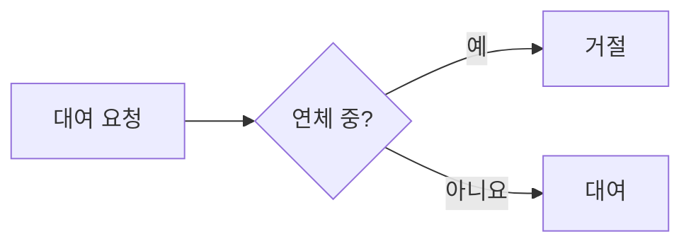

# 포트폴리오 블로그 실습 — 실습 기록을 Zensical·GitHub Pages로 배포하기 (Mac)

Java·Spring 실습을 하며 쓴 마크다운(md) 기록을 **나만의 포트폴리오 블로그**로 배포하는 실습입니다. 결과물은 `https://<GitHub 아이디>.github.io/` 주소의 사이트이고, 실습 글을 `git push` 하면 몇 분 뒤 사이트에 자동으로 반영됩니다. 완성 모습은 [예시 사이트](https://goodjwon.github.io/portfolio-test/)에서 볼 수 있습니다. 모든 명령은 Mac 터미널 기준입니다.

!!! example "실습 위치·실행"

    - **위치**: 홈 디렉터리 아래 `~/<GitHub 아이디>.github.io` (Step 2에서 만듭니다)
    - **준비물**: Mac, GitHub 계정, 진행 중인 실습 하나 (예: [[guide-java-practice-spring-library]])
    - **걸리는 시간**: 설치·배포 1시간, 글 1편 30분~1시간
    - **비용**: 없음 (GitHub 공개 저장소 + GitHub Pages 무료)

## 0. 왜 이렇게 만드는가

포트폴리오 블로그는 꾸밈보다 **직접 만들고 검증한 기록**이 핵심입니다. 이 가이드의 규칙은 실제 운영 사례에서 나왔습니다.

| 사례 (2026-10, 이 위키를 운영하는 저자의 블로그) | 결과 | 이 실습의 규칙 |
|---|---|---|
| 유튜브 영상을 요약한 글 43편을 올림 | Google 색인이 사이트 전체에서 4개까지 줄어듦 | 남의 글·영상 요약은 올리지 않습니다. **직접 실행한 결과만** 씁니다 |
| 같은 요약 글을 저장소 커밋·실행 로그·실측값 기반으로 다시 씀 | 글마다 고유한 근거가 생김 | 글마다 **커밋 링크·테스트 결과·스크린샷 중 하나 이상**을 붙입니다 |
| 강의 페이지 93개가 같은 제목(H1)을 공유 | 템플릿 복제 페이지처럼 보여 색인되지 않음 | 글 제목에는 **무엇을 했는지**를 넣습니다 ("3주차 과제" ✗) |

면접관이 보는 것도 같습니다. "무엇을 배웠다"보다 "무엇이 왜 안 됐고, 어떻게 확인하고 고쳤는가"가 실력을 보여 줍니다.

## 1. 도구 고르기 — 왜 Zensical인가

정적 사이트 생성기는 md 파일 묶음을 HTML 사이트로 바꿔 주는 프로그램입니다. 이 위키와 저자의 블로그는 **MkDocs + Material for MkDocs**로 만들었는데, 2026년 들어 이 조합에 수명 문제가 생겼습니다.

| 도구 | 상태 (2026-10-24 확인) | 이 실습에서의 역할 |
|---|---|---|
| MkDocs 1.x | 18개월간 릴리스 없음, 2026-10-02 외부 기여 중단 | 사용하지 않음 |
| MkDocs 2.0 | 사전 공개판(2.0.dev2). 플러그인 제거·설정 형식 변경으로 **기존 프로젝트와 호환되지 않음** | 사용하지 않음 |
| Material for MkDocs 9.7.x | 치명적 버그 수정만 진행, **2027-05-05 지원 종료** | 비상 대안 (Step 9) |
| **Zensical** 0.0.72 | Material 팀이 만든 후속 도구. 알파 단계지만 거의 매주 릴리스, 블로그 기능 지원(0.0.64부터) | **기본 도구** |
| Starlight 0.42 (Astro) | 안정적이지만 Node 프로젝트(`node_modules` 217MB), 블로그는 커뮤니티 플러그인, front matter `title` 필수 | 사용하지 않음 (Java 학생에게 도구 사슬이 하나 더 늘어남) |

Zensical은 Material for MkDocs의 설정 파일(`mkdocs.yml`)을 그대로 읽습니다. 그래서 이 실습은 설정을 `mkdocs.yml` 하나로 작성합니다. Zensical에 문제가 생기면 빌드 명령 한 줄만 바꿔 Material for MkDocs로 돌아갈 수 있습니다(Step 9). 알파 단계 도구이므로 버전은 고정해서 씁니다.

!!! note "이 가이드의 검증 범위"
    전 과정을 2026-10-24에 Mac(Apple Silicon, macOS 27)에서 실행해 확인했습니다. 테스트 저장소에 Zensical 0.0.72로 배포하고, 글 추가 push의 자동 반영과 Step 9 비상 대안(Material for MkDocs 9.7.7) 배포까지 GitHub Actions에서 성공했습니다. Step 7의 워크플로는 `zensical new`가 만들어 주는 공식 워크플로에 버전 고정과 수동 실행 트리거만 더한 것입니다.

## 2. 설치 (Mac)

설치할 것은 네 가지입니다. Homebrew는 Mac용 설치 관리자이고, 나머지는 모두 Homebrew로 설치합니다.

| 도구 | 용도 |
|---|---|
| Homebrew | 나머지 도구 설치 |
| git, gh | 저장소 관리, GitHub 로그인·저장소 생성 |
| uv | Python 도구 설치 관리자. Zensical을 설치하고 필요한 Python도 알아서 받습니다 |
| Zensical | md → 사이트 변환 |

Homebrew가 없으면 먼저 설치합니다. 이미 있으면 건너뜁니다.

```bash
brew --version || /bin/bash -c "$(curl -fsSL https://raw.githubusercontent.com/Homebrew/install/HEAD/install.sh)"
```

git·gh·uv를 설치하고, uv로 Zensical을 설치합니다. `uv tool update-shell`은 Zensical 실행 파일 경로를 셸 설정에 추가하는 명령이므로, 실행한 뒤 **터미널을 닫았다가 새로 엽니다**.

```bash
brew install git gh uv
uv tool install zensical==0.0.72
uv tool update-shell
```

새 터미널에서 설치를 확인합니다.

```bash
git --version
uv --version
zensical --version
```

```text
예상 결과
git version 2.x.x
uv 0.x.x
0.0.72
```

`zensical: command not found`가 나오면 터미널을 새로 열지 않은 경우입니다. 새 창에서 다시 확인합니다.

마지막으로 GitHub에 로그인합니다. 질문이 나오면 `GitHub.com` → `HTTPS` → `Login with a web browser`를 고르고, 화면의 코드를 브라우저에 입력합니다.

```bash
gh auth login
gh auth status
```

`Logged in to github.com account <아이디>`가 출력되면 정상입니다.

## 3. 사이트 뼈대 만들기

저장소 이름을 `<GitHub 아이디>.github.io`로 만들면 사이트 주소가 `https://<아이디>.github.io/`가 됩니다. 이력서에 적기 좋은 짧은 주소라서 이 이름을 씁니다. 아래 명령의 `gildong`을 **자기 GitHub 아이디로 바꿔서** 실행합니다.

```bash
ID=gildong                                  # ← 자기 GitHub 아이디
mkdir -p ~/$ID.github.io/docs/blog/posts
cd ~/$ID.github.io
git init
printf 'site/\n.DS_Store\n.cache/\n' > .gitignore
```

이 실습이 끝나면 디렉터리는 아래 구조가 됩니다. 지금은 `docs/blog/posts`까지만 있으면 됩니다.

```text
~/gildong.github.io/
├── mkdocs.yml                     ← 사이트 설정 (Step 3)
├── .github/workflows/docs.yml     ← 자동 배포 (Step 7)
└── docs/                          ← 사이트에 올라가는 md
    ├── index.md                   ← 첫 화면 (자기소개)
    ├── stylesheets/extra.css      ← 글꼴·첫 화면 스타일 (Step 3-1)
    └── blog/
        ├── index.md               ← 글 목록 페이지
        └── posts/
            └── 2026-10-24-library-loan/   ← 글 1편 = 디렉터리 1개
                ├── index.md
                └── images/
```

**파일**: `mkdocs.yml` — 사이트 이름·주소·메뉴·블로그·마크다운 기능을 정하는 설정 파일입니다. 이름·아이디 다섯 곳을 자기 것으로 바꿉니다.

```yaml
site_name: 홍길동의 개발 기록
site_url: https://gildong.github.io/
site_description: Java·Spring 실습을 직접 만들고 검증한 기록
site_author: 홍길동
repo_url: https://github.com/gildong/gildong.github.io

nav:
  - 소개: index.md
  - 실습 기록:
      - blog/index.md

theme:
  name: material
  language: ko
  features:
    - content.code.copy
    - navigation.top
    - navigation.footer
    - search.highlight
  palette:
    - media: "(prefers-color-scheme: light)"
      scheme: default
      toggle:
        icon: material/weather-night
        name: 어두운 화면으로
    - media: "(prefers-color-scheme: dark)"
      scheme: slate
      toggle:
        icon: material/weather-sunny
        name: 밝은 화면으로

plugins:
  - search
  - blog:
      post_url_format: "{slug}"

markdown_extensions:
  - admonition
  - attr_list
  - md_in_html
  - footnotes
  - toc:
      permalink: true
  - pymdownx.details
  - pymdownx.highlight:
      anchor_linenums: true
  - pymdownx.inlinehilite
  - pymdownx.superfences:
      custom_fences:
        - name: mermaid
          class: mermaid
          format: !!python/name:pymdownx.superfences.fence_code_format
  - pymdownx.tabbed:
      alternate_style: true
  - pymdownx.tasklist:
      custom_checkbox: true
```

설정에서 알아 둘 세 줄은 다음과 같습니다.

| 설정 | 뜻 |
|---|---|
| `language: ko` | 검색·버튼 문구를 한국어로 표시하고 `<html lang="ko">`를 붙입니다 |
| `post_url_format: "{slug}"` | 글 주소를 `/blog/<slug>/`로 짧게 만듭니다. 지정하지 않으면 날짜와 한글 제목이 주소에 들어갑니다 |
| `superfences` 의 `mermaid` | ` ```mermaid ` 코드블록을 흐름도로 그립니다 |

**파일**: `docs/index.md` — 사이트 첫 화면입니다. 자기소개와 GitHub 주소를 적습니다.

```markdown
# 홍길동의 개발 기록

Java·Spring을 배우며 **직접 만들고 테스트로 검증한 실습**을 기록합니다.

- GitHub: [gildong](https://github.com/gildong)
- 실습 기록: [목록 보기](blog/index.md)
```

**파일**: `docs/blog/index.md` — 글 목록 페이지입니다. 제목 한 줄만 두면 블로그 기능이 글 목록을 자동으로 채웁니다.

```markdown
# 실습 기록
```

### 3-1. 디자인 다듬기

Zensical은 기본으로 모던 테마를 씁니다. 여기에 한글 글꼴, 첫 화면, 강조색 세 가지를 더하면 포트폴리오다운 모습이 됩니다. 완성 모습은 [예시 사이트](https://goodjwon.github.io/portfolio-test/)에서 볼 수 있습니다.

| 바꾸는 것 | 효과 |
|---|---|
| 글꼴 Pretendard | 한글 글자가 고르고 또렷하게 보입니다 |
| 첫 화면 | 큰 제목, 소개 한 줄, 버튼 2개, 대표 실습 카드 3개 |
| 상단 탭 메뉴 | 왼쪽 메뉴 대신 머리글에 "소개·실습 기록" 탭이 생깁니다 |
| 날짜 형식 | 글 날짜가 "2026년 10월 24일"로 표시됩니다 |
| 바닥글 | "Made with Zensical" 문구를 숨깁니다 |

**파일**: `mkdocs.yml` — 기존 설정에서 아래 부분만 고칩니다. `features`에 한 줄, `palette`의 두 항목에 각각 두 줄, `extra`·`extra_css` 블록, 블로그의 `post_date_format`, 그리고 `nav`의 글 목록 제목입니다.

```yaml
nav:
  - 소개: index.md
  - 실습 기록:
      - 실습 기록: blog/index.md

theme:
  features:
    - content.code.copy
    - navigation.top
    - navigation.footer
    - search.highlight
    - navigation.tabs                  # 추가: 상단 탭 메뉴
  palette:
    - media: "(prefers-color-scheme: light)"
      scheme: default
      primary: white                   # 추가
      accent: indigo                   # 추가
      toggle:
        icon: material/weather-night
        name: 어두운 화면으로
    - media: "(prefers-color-scheme: dark)"
      scheme: slate
      primary: black                   # 추가
      accent: indigo                   # 추가
      toggle:
        icon: material/weather-sunny
        name: 밝은 화면으로

extra:                                 # 추가: 바닥글 'Made with Zensical' 숨김
  generator: false

extra_css:                             # 추가
  - stylesheets/extra.css

plugins:
  - search
  - blog:
      post_url_format: "{slug}"
      post_date_format: "yyyy년 M월 d일"   # 추가
```

**파일**: `docs/stylesheets/extra.css` — 글꼴과 첫 화면 모양을 정하는 스타일 파일입니다. 그대로 복사합니다.

```css
/* 한글 글꼴: Pretendard */
@import url("https://cdn.jsdelivr.net/gh/orioncactus/pretendard@v1.3.9/dist/web/variable/pretendardvariable-dynamic-subset.min.css");

:root {
  --md-text-font: "Pretendard Variable";
}

/* 첫 화면 */
.hero { padding: 3rem 0 2rem; }
.hero h1 { font-size: 2.6rem; font-weight: 800; letter-spacing: -0.02em; margin-bottom: 0.6rem; }
.hero .lead { font-size: 1.15rem; opacity: 0.75; margin-bottom: 1.6rem; }
.hero .md-button { margin: 0 0.4rem 0.4rem 0; border-radius: 999px; }
.hero h1, .hero .lead { word-break: keep-all; }

@media screen and (max-width: 44.9375em) {
  .hero { padding: 1.5rem 0 1rem; }
  .hero h1 { font-size: 1.9rem; }
}
```

**파일**: `docs/index.md` — 첫 화면을 아래 내용으로 바꿉니다. 맨 위 `hide`는 첫 화면에서만 왼쪽 메뉴와 목차를 숨기는 설정입니다. 카드는 자기 실습으로 채우고, 글이 있는 카드에는 `글 읽기` 링크를 답니다.

```markdown
---
hide:
  - navigation
  - toc
---

<div class="hero" markdown>

# 홍길동의 개발 기록

<p class="lead">Java·Spring을 배우며 직접 만들고 테스트로 검증한 실습을 기록합니다.</p>

[실습 기록 보기](blog/index.md){ .md-button .md-button--primary }
[GitHub](https://github.com/gildong){ .md-button }

</div>

## 이런 걸 해 봤습니다

<div class="grid cards" markdown>

-   **도서 대여 API**

    ---

    연체 회원 대여 금지 규칙을 경계값 테스트로 고정했습니다.

    [글 읽기](blog/posts/2026-10-24-library-loan/index.md)

-   **콘솔 도서 관리**

    ---

    컬렉션 선택을 바꿔 검색 속도를 비교했습니다.

-   **계층 분리 리팩터링**

    ---

    서비스 테스트가 빨라진 이유를 정리했습니다.

</div>

## 다룰 줄 아는 것

Java 21 · Spring Boot · JPA · JUnit 5 · Git · GitHub Actions
```

미리보기(Step 4)에서 첫 화면에 큰 제목과 둥근 버튼 두 개, 카드 세 장이 보이면 정상입니다. 카드 안의 `글 읽기` 링크는 Step 5에서 그 글을 만든 뒤에야 열립니다. 글 화면 왼쪽 위의 "Index로 돌아가기"는 Zensical에 들어 있는 한국어 번역 문구라서 설정으로 바뀌지 않습니다.

## 4. 미리보기와 빌드

글을 쓰는 동안에는 미리보기 서버를 띄워 둡니다. 파일을 저장할 때마다 브라우저 화면이 자동으로 다시 그려집니다.

```bash
cd ~/$ID.github.io     # 새 터미널이면 ID=<아이디> 를 다시 지정하거나 경로를 직접 입력
zensical serve --open
```

```text
예상 결과
Serving /Users/<사용자>/gildong.github.io/site on http://localhost:8000
Build started
No issues found
```

브라우저에 "홍길동의 개발 기록" 첫 화면이 열리면 정상입니다. 서버는 `Ctrl+C`로 멈춥니다.

배포 전에는 한 번 전체 빌드로 오류가 없는지 확인합니다. 결과물은 `site/` 디렉터리에 생기며, `.gitignore`에 넣었으므로 저장소에는 올라가지 않습니다.

```bash
zensical build --clean
```

```text
예상 결과
Build started
No issues found
Build finished in 0.2s
```

## 5. 실습 기록을 글로 옮기기

이 Step이 실습의 본론입니다. 진행 중인 실습 하나를 글 1편으로 만듭니다. 글 1편은 **디렉터리 1개**로 만들고, 글에 쓰는 이미지를 같은 디렉터리의 `images/`에 둡니다. 글과 이미지가 한곳에 있어서 옮기거나 지울 때 실수가 없습니다.

```bash
mkdir -p docs/blog/posts/2026-10-24-library-loan/images
```

실습 저장소에 이미 정리해 둔 md(예: `README.md`, 회고 노트)가 있으면 복사해서 시작합니다. 경로는 자기 실습 저장소 위치로 바꿉니다.

```bash
cp ~/study/spring-library/README.md docs/blog/posts/2026-10-24-library-loan/index.md
```

글 맨 위에는 **front matter**를 붙입니다. front matter는 `---` 두 줄 사이에 쓰는 글 정보이고, 블로그 기능이 이 값으로 날짜·분류·주소를 정합니다.

| 키 | 필수 | 뜻 |
|---|---|---|
| `date` | 필수 | 작성일 `YYYY-MM-DD`. 목록 정렬과 연도별 보관함에 쓰입니다 |
| `slug` | 권장 | 주소에 들어갈 영문 이름. 소문자와 하이픈만 씁니다 |
| `categories` | 선택 | 분류 이름. 분류별 목록 페이지가 자동으로 생깁니다 |

글 본문은 아래 틀을 따릅니다. **문제 → 원인 → 해결 → 검증 → 배운 점** 순서는 면접에서 프로젝트를 설명하는 순서와 같습니다. `<!-- more -->` 위의 문단은 글 목록에 요약으로 표시됩니다.

**파일**: `docs/blog/posts/2026-10-24-library-loan/index.md`

````markdown
---
date: 2026-10-24
slug: library-loan-overdue-rule
categories:
  - Spring
---

# 도서 대여 API — 연체 회원 대여 금지 규칙을 테스트로 고정하기

도서관 실습에서 "연체 중인 회원은 빌릴 수 없다" 규칙을 구현했습니다. 처음 구현은 화면에서는 잘 동작했지만 테스트를 붙이자 경계값에서 실패했습니다.

<!-- more -->

## 1. 문제

반납 예정일 당일에 반납하지 않은 회원이 대여에 성공했습니다.

## 2. 원인

```java
if (member.overdueDays() > 0) {
    throw new LoanNotAllowedException(member.id());
}
```

연체일 계산이 날짜 차이를 내림해서 당일 연체가 0일로 계산됐습니다.

## 3. 해결과 검증




- 수정 커밋: [a1b2c3d](https://github.com/gildong/spring-library/commit/a1b2c3d)
- [x] 경계값 테스트 3건 추가
- [ ] 반납 기능은 다음 글에서

!!! note "배운 점"
    규칙은 테스트 이름으로 먼저 적고 구현합니다.
````

테스트 통과 화면은 `Cmd+Shift+4`로 캡처해서 `images/test-result.png`로 저장합니다(Step 6의 편집기 설정을 하면 붙여넣기만으로 저장됩니다). 미리보기 서버에서 "실습 기록" 메뉴에 글이 보이고, 글 주소가 `http://localhost:8000/blog/library-loan-overdue-rule/`이면 정상입니다.

실습별로 이런 글을 쓸 수 있습니다.

| 실습 | 글 제목 예시 (무엇을 했는지가 드러나게) |
|---|---|
| [[guide-java-practice-core]] | "콘솔 도서 관리 — 컬렉션 선택을 바꿔 검색 속도를 비교한 기록" |
| [[guide-java-practice-spring-library]] | "도서 대여 API — 연체 회원 대여 금지 규칙을 테스트로 고정하기" |
| [[guide-java-practice-library-book-search]] | "카카오 책 검색 API 연동 — API 키를 코드에서 빼낸 과정" |
| [[guide-java-practice-layered-quotation]] | "계층 분리 리팩터링 — 서비스 테스트가 빨라진 이유" |

!!! warning "글에 넣지 말 것"
    API 키·비밀번호·`.env` 내용, 다른 사람의 글이나 영상을 요약한 내용, 직접 실행하지 않은 결과. 공개 저장소에 한 번 올라간 키는 지워도 기록에 남으므로 **즉시 키를 재발급**해야 합니다.

## 6. 편한 md 편집기 — VS Code 또는 Obsidian

md는 아무 편집기로나 쓸 수 있지만, 미리보기와 이미지 붙여넣기가 되면 훨씬 편합니다. Notion처럼 별도 서비스에 쓰면 내보내기 과정이 필요하므로, **사이트 저장소의 파일을 직접 여는 편집기**를 씁니다. 둘 중 하나를 고릅니다.

| | VS Code | Obsidian |
|---|---|---|
| 추천 대상 | 이미 코드 편집기로 쓰는 학생 | 글쓰기 화면이 따로 있는 게 편한 학생 |
| 미리보기 | `Cmd+K` → `V` (옆 창 미리보기) | 편집 화면 자체가 미리보기 |
| 이미지 붙여넣기 | 설정 한 줄로 `images/`에 저장 | 설정 세 개로 `images/`에 저장 |
| 주의점 | 없음 | `[[위키링크]]` 형식을 꺼야 함 |
| 설치 | `brew install --cask visual-studio-code` | `brew install --cask obsidian` |

### 6-1. VS Code 설정

사이트 저장소를 VS Code로 엽니다.

```bash
code ~/$ID.github.io
```

`Cmd+Shift+P` → `Preferences: Open User Settings (JSON)`을 열고 아래 항목을 추가합니다. 캡처한 이미지를 md 편집 화면에 `Cmd+V`로 붙여 넣으면 글과 같은 디렉터리의 `images/`에 파일이 저장되고 링크가 자동으로 들어갑니다.

```json
"markdown.copyFiles.destination": {
  "**/*.md": "images/"
}
```

### 6-2. Obsidian 설정

Obsidian을 실행하고 `Open folder as vault`로 **`~/<아이디>.github.io/docs`** 디렉터리를 엽니다. Obsidian이 만드는 `.obsidian/` 설정 디렉터리는 사이트 빌드에서 자동으로 제외됩니다.

Obsidian은 기본값으로 `[[문서명]]` 형식의 위키링크를 만드는데, Zensical은 이 형식을 링크로 바꾸지 않습니다(2026-10-24 확인: `[[blog/index]]`가 글자 그대로 출력됨). `Settings` → `Files and links`에서 아래 세 가지를 바꿔 표준 마크다운 링크를 쓰게 합니다.

| 설정 | 값 |
|---|---|
| Use [[Wikilinks]] | 끔 |
| New link format | Relative path to file |
| Default location for new attachments | In subfolder under current folder, 하위 디렉터리 이름 `images` |

설정 후 이미지를 붙여 넣었을 때 `![[test-result.png]]`가 아니라 `` 형식으로 들어가면 정상입니다.

## 7. GitHub Pages로 배포

GitHub Actions는 저장소에 push할 때마다 GitHub 서버에서 명령을 실행해 주는 기능입니다. 아래 워크플로가 push마다 사이트를 빌드해서 GitHub Pages에 올립니다.

**파일**: `.github/workflows/docs.yml`

```yaml
name: Documentation
on:
  push:
    branches:
      - master
      - main
  workflow_dispatch:               # 수동 실행 (gh workflow run)
permissions:
  contents: read
  pages: write
  id-token: write
jobs:
  deploy:
    environment:
      name: github-pages
      url: ${{ steps.deployment.outputs.page_url }}
    runs-on: ubuntu-latest
    steps:
      - uses: actions/configure-pages@v6
      - uses: actions/checkout@v7
      - uses: actions/setup-python@v6
        with:
          python-version: 3.x
      - run: pip install zensical==0.0.72    # 로컬과 같은 버전으로 고정
      - run: zensical build --clean
      - uses: actions/upload-pages-artifact@v5
        with:
          path: site
      - uses: actions/deploy-pages@v5
        id: deployment
```

GitHub에 공개 저장소를 만들고 첫 커밋을 올립니다. `gh repo create`의 `--source .` 는 현재 디렉터리를 그대로 저장소로 올린다는 뜻입니다.

```bash
cd ~/$ID.github.io
git add .gitignore mkdocs.yml docs .github
git commit -m "포트폴리오 블로그 시작"
gh repo create $ID.github.io --public --source . --push
```

저장소의 Pages 배포 방식을 GitHub Actions로 지정합니다. 브라우저에서 저장소 → `Settings` → `Pages` → `Build and deployment`의 `Source`를 **GitHub Actions**로 바꿔도 같습니다.

```bash
gh api -X POST repos/$ID/$ID.github.io/pages -f build_type=workflow
```

첫 push는 Pages 설정 전에 실행됐으므로 배포를 한 번 더 실행하고, 끝날 때까지 지켜봅니다.

```bash
gh workflow run docs.yml
gh run watch
```

실행이 완료(✓)로 끝나고 `https://<아이디>.github.io/`에 첫 화면이 보이면 정상입니다. 이후에는 글을 쓰고 아래 세 줄만 실행하면 배포됩니다.

```bash
git add docs
git commit -m "글: 도서 대여 연체 규칙"
git push
```

## 8. Google에 등록하기 (Search Console)

사이트를 만들어도 Google이 모르면 검색에 나오지 않습니다. Search Console에 사이트를 등록하고 sitemap(사이트의 전체 주소 목록)을 제출합니다.

1. [Search Console](https://search.google.com/search-console)에서 `속성 추가` → **URL 접두어**에 `https://<아이디>.github.io/`를 입력합니다.
2. 확인 방법으로 **HTML 파일**을 고르고, 내려받은 `google*.html` 파일을 `docs/`에 넣어 push합니다. `docs/`의 파일은 사이트 최상위 주소로 그대로 복사됩니다.
3. 배포가 끝나면 Search Console에서 `확인`을 누릅니다.
4. 왼쪽 `Sitemaps` 메뉴에 `sitemap.xml`을 입력하고 제출합니다. sitemap은 빌드할 때 자동으로 만들어집니다.

색인되기까지 보통 며칠에서 몇 주가 걸립니다. "크롤링됨 - 현재 색인이 생성되지 않음"이 많이 보이면 Step 0의 표를 다시 보고, 요약 글이나 제목이 비슷한 글이 없는지 점검합니다.

## 9. 비상 대안 — Material for MkDocs로 빌드하기

Zensical은 알파 단계라서 업데이트 후 빌드가 깨질 수 있습니다. 그때는 같은 `mkdocs.yml`을 Material for MkDocs로 빌드합니다. `uvx`는 설치 없이 도구를 한 번 실행하는 uv 명령입니다.

```bash
uvx --with mkdocs-material==9.7.7 mkdocs build --clean
```

```text
예상 결과
INFO    -  Cleaning site directory
INFO    -  Building documentation to directory: /Users/<사용자>/gildong.github.io/site
INFO    -  Documentation built in 0.23 seconds
```

이 명령이 성공하면 `.github/workflows/docs.yml`의 두 줄을 아래처럼 바꿔 배포도 전환합니다. Material for MkDocs는 2027-05-05까지 치명적 버그 수정을 받으므로, 그 전에 Zensical 문제가 풀리면 다시 되돌립니다. 이 상태에서는 Step 3-1의 모던 테마가 Material 기본 모양으로 돌아갑니다. 글꼴·첫 화면·카드는 그대로 유지됩니다.

```yaml
      - run: pip install mkdocs-material==9.7.7
      - run: mkdocs build --clean
```

## 10. 막혔을 때 참고

| 증상 | 원인 | 해결 |
|---|---|---|
| `zensical: command not found` | `uv tool update-shell` 후 터미널을 새로 열지 않음 | 새 터미널 창에서 다시 실행 |
| `Error: Address already in use` | 다른 프로그램이 8000 포트를 사용 중 | `zensical serve -a localhost:8010 --open` 처럼 포트를 바꿈 |
| 글이 목록에 안 보임 | front matter에 `date`가 없거나 `docs/blog/posts/` 밖에 있음 | 경로와 `date: YYYY-MM-DD` 확인 |
| 글 주소에 날짜와 한글이 들어감 | `slug` 미지정 | front matter에 `slug: 영문-주소` 추가 |
| 이미지가 깨짐 | Obsidian 위키링크 형식(`![[ ]]`)으로 삽입됨 | Step 6-2 설정 후 `` 형식으로 다시 삽입 |
| `[[문서]]`가 글자 그대로 보임 | Zensical은 위키링크를 변환하지 않음 | `[제목](../다른-글/index.md)` 형식으로 바꿈 |
| Actions에서 `deploy` 실패, "Pages not enabled" | Pages Source가 GitHub Actions가 아님 | Step 7의 `gh api` 명령 또는 Settings → Pages 설정 |
| 사이트가 404 | 첫 배포 직후 반영 지연 | `gh run watch`가 끝난 뒤 1~2분 후 새로고침 |
| `<아이디>.github.io`가 아닌 이름으로 저장소를 만듦 | 주소가 `https://<아이디>.github.io/<저장소>/`가 됨 | `mkdocs.yml`의 `site_url`을 그 주소로 바꿈 (안 바꾸면 sitemap·canonical 주소가 틀림) |
| 첫 화면 카드가 세로 목록으로 보임 | `attr_list`·`md_in_html` 확장이 빠졌거나 카드 줄 앞 공백이 4칸이 아님 | Step 3 `markdown_extensions` 확인, `-   ` 뒤 내용은 공백 4칸 들여쓰기 |
| 빌드는 되는데 화면이 이상함 | Zensical 버전 변경 | 버전 고정 확인, 안 되면 Step 9 |

## 같은 인사이트 패턴 — 검증된 것만 남긴다

| 페이지 | 판정을 누가 하는가 | 이 실습에서 같은 원리 |
|---|---|---|
| [[concept-loop-engineering]] | 에이전트의 "고쳤습니다"가 아니라 테스트의 종료 코드 | 글의 "해결했다"가 아니라 커밋·테스트 결과 |
| [[concept-harness-engineering]] | 부탁(프롬프트) 대신 구조(검사 스크립트) | 다짐 대신 빌드(`zensical build`)와 Search Console 결과 |
| [[guide-deploy-mkdocs-firebase]] | 빌드에서 `No issues found`여야 배포 | 같은 Zensical을 쓰는 Firebase 배포판. 이 가이드는 무료·학생용으로 GitHub Pages를 씀 |

## 체크리스트

- [ ] `https://<아이디>.github.io/`에 첫 화면이 보입니다
- [ ] 실습 글 1편 이상이 "실습 기록"에 있고, 주소가 영문 slug입니다
- [ ] 글마다 커밋 링크·테스트 결과·스크린샷 중 하나 이상 있습니다
- [ ] 글 제목에 무엇을 했는지가 드러납니다
- [ ] 글에 API 키·비밀번호가 없습니다
- [ ] Search Console에 sitemap을 제출했습니다
- [ ] Zensical 버전이 로컬과 워크플로에서 같습니다

## 원본 출처

- Material for MkDocs 팀, [MkDocs 2.0 분석](https://squidfunk.github.io/mkdocs-material/blog/2026/02/18/mkdocs-2.0/) — MkDocs 1.x 유지 중단, 2.0 비호환, Material 지원 종료일
- [Zensical 문서 — 사이트 배포](https://zensical.org/docs/publish-your-site/) · [블로그 설정](https://zensical.org/docs/setup/blog/) · [플러그인 호환 표](https://zensical.org/compatibility/plugins/)
- [Zensical PyPI](https://pypi.org/project/zensical/) — 0.0.72 (2026-10-23)
- 실행 검증: 2026-10-24, Zensical 0.0.72 · mkdocs-material 9.7.7 · uv로 같은 `mkdocs.yml`을 양쪽 빌드

## 관련 페이지

- [[guide-java-learning-path]] — 글감이 되는 실습 전체 지도
- [[guide-deploy-mkdocs-firebase]] — 이 위키의 배포 방식 (Zensical + Firebase)
- [[entity-obsidian]] — Obsidian 기능 정리
- [[guide-wiki-authoring-standards]] — 글 구조·문체 기준
